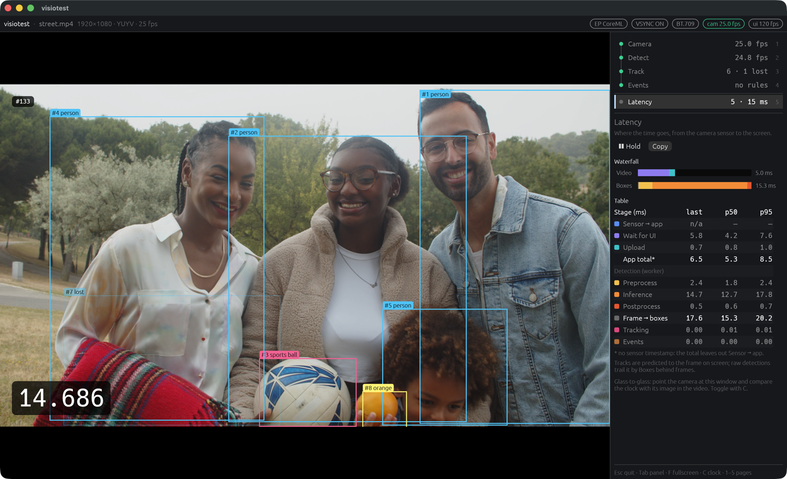

# visiotest

A live **webcam → detect → track → events** pipeline in Rust that measures its own
latency stage by stage.



- **Capture**: raw YUYV frames from the webcam ([nokhwa](https://crates.io/crates/nokhwa)),
  converted to RGB on the GPU in a WGSL shader.
- **Detect**: YOLO11n through ONNX Runtime ([ort](https://crates.io/crates/ort)), on the CPU
  or the CoreML execution provider. Preprocessing (letterbox, normalise) and
  postprocessing (decode, NMS) are written by hand.
- **Track**: a ByteTrack-style tracker, also by hand: a constant-velocity Kalman filter,
  gated IoU matching and a Hungarian assignment solver. Boxes are predicted to the time
  of the frame on screen, so they line up with the image even when the detector runs less
  often than the camera.
- **Events**: line crossings (with direction) and zone enter / dwell / exit, drawn with
  the mouse on the video and printed as JSON lines on stdout.
- **Dashboard** ([egui](https://crates.io/crates/egui)): the video with boxes and rules,
  plus a side panel with every stage's numbers and a per-stage latency table
  (`last` / `p50` / `p95`).

This is a learning project. The vision parts are written by hand on purpose, so they can
be read and studied; each module starts with a doc comment that explains its idea.

## Requirements

- Rust (edition 2024) and [uv](https://docs.astral.sh/uv/) for the one-off model export.
- A webcam that delivers **YUYV** frames. Developed and tested on macOS (Apple silicon,
  built-in FaceTime HD camera); other platforms are untested. The webcam is optional:
  with `--video`, a video file stands in for it (see [Without a camera](#without-a-camera)).
- On macOS the terminal needs camera permission; the first run asks for it.

## Quick start

```sh
# 1. Export the model once (downloads Ultralytics' YOLO11n weights, writes models/yolo11n.onnx)
cd model-export && uv run export.py && cd ..

# 2. Run (the first build downloads a prebuilt ONNX Runtime)
cargo run --release
```

Latency and FPS numbers only mean something in `--release` builds.

## Without a camera

Any video file can stand in for the webcam. ffmpeg decodes it and visiotest plays
it in real time, looped:

```sh
cargo run --release -- --video street.mp4
```

This needs `ffmpeg` and `ffprobe` on the `PATH` (`brew install ffmpeg`). Frames
larger than 1920×1080 are scaled down. A file has no sensor timestamp, so the
Latency page's total leaves out Sensor → app (`App total*`). Phone clips play
unrotated.

## Options

```sh
cargo run -- --list                          # list cameras and the opened format
cargo run --release -- --video clip.mp4      # a looped video file instead of the camera (needs ffmpeg)
cargo run --release -- --ep coreml           # execution provider: cpu (default) | coreml
cargo run --release -- --detect-interval auto   # every (default) | auto | <ms> (1–500)
cargo run --release -- --no-detect           # video only: no model, no detector thread
cargo run --release -- --no-vsync            # lowest latency, may tear
cargo run --release -- --matrix bt601        # YUV colour matrix: bt709 (default) | bt601
cargo run --release -- --model path/to.onnx  # default models/yolo11n.onnx
cargo run --release -- --rules my.json       # lines and zones file (default rules.json)
cargo run --release -- --events off          # no event lines (counts still run)
```

## Keys

| Key | |
|---|---|
| Esc | quit (in edit mode: cancel the draft, then the selection, then leave edit mode) |
| Tab | show / hide the side panel |
| F | fullscreen |
| C | clock on / off |
| D | boxes on / off |
| T | tracks ↔ raw detections |
| E | edit mode: draw lines and zones on the video |
| 1–5 | side panel page: Camera, Detect, Track, Events, Latency |

In edit mode, drag to draw a line (Shift snaps it horizontal or vertical), click corners
to draw a zone (Enter closes it), and Delete removes the selected rule.

## Events

Lines and zones are saved to `rules.json`. Each event is one JSON line on **stdout**;
every other message goes to stderr, so the output can be piped:

```sh
cargo run --release | jq
```

```json
{"type":"line_cross","t":1792312345678,"seq":1042,"rule":1,"rule_name":"door","track":7,"class":"person","dir":"a_to_b"}
```

Other types are `zone_enter`, `zone_dwell` and `zone_exit` (with `dwell_s`; an exit also
has `reason`: `left` or `lost`). `t` is when the frame arrived, in Unix milliseconds.

## Measuring latency

The Latency page breaks a frame's journey into stages: sensor → app, wait for the UI,
upload and convert, and on the detector thread preprocess, inference, postprocess,
tracking and events. On a MacBook M1 Pro with its 1080p camera, the video path takes about
80 ms (p50), almost all of it before the frame reaches the app; YOLO11n inference takes
about 29 ms on the CPU and 12 ms with CoreML.

For glass-to-glass latency, point the camera at the window: the large clock in the corner
is read just before the frame is drawn, so the difference between the clock and its image
in the video is the end-to-end delay.

## Tests

```sh
cargo test
cargo test --release sim_report -- --ignored --nocapture         # tracker: ID switches per scene × pacing mode
cargo test --release events_sim_report -- --ignored --nocapture  # events: counted vs expected crossings
```

The tests need no camera, window, GPU or model file. The tracker and the event engine
are checked on deterministic synthetic scenes (`src/track/sim/`).

## Layout

```
src/
  capture/, video.rs, yuyv.wgsl     webcam or video-file frames → GPU texture
  detect/                           preprocessing, ONNX model, postprocessing, NMS, detector thread
  track/                            Kalman filter, Hungarian assignment, ByteTrack
  events/                           geometry, line and zone state machines, event engine
  emit/                             JSON event lines on stdout
  ui/                               the egui dashboard and the rule editor
model-export/                       Python (uv) script that exports YOLO11n to ONNX
```

## License

The code in this repository is licensed under either of

- Apache License, Version 2.0 ([LICENSE-APACHE](LICENSE-APACHE))
- MIT license ([LICENSE-MIT](LICENSE-MIT))

at your option.

The model is not part of this repository. YOLO11 and the
[Ultralytics](https://github.com/ultralytics/ultralytics) package that exports it are
**AGPL-3.0**; see [model-export/README.md](model-export/README.md).
